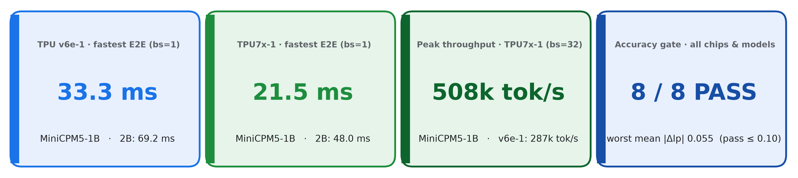
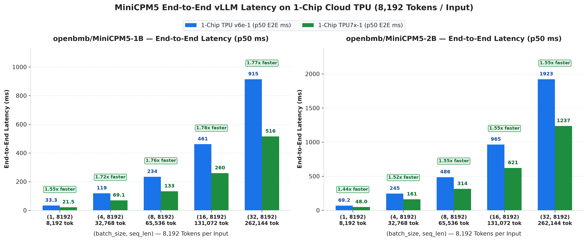
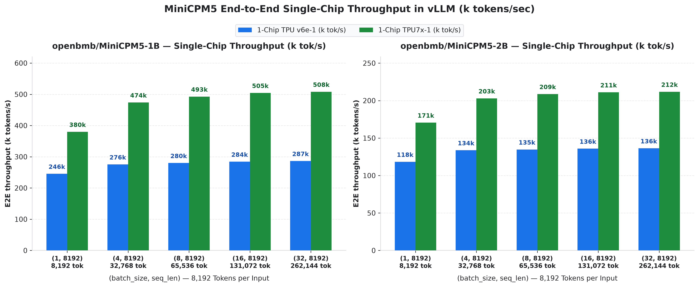
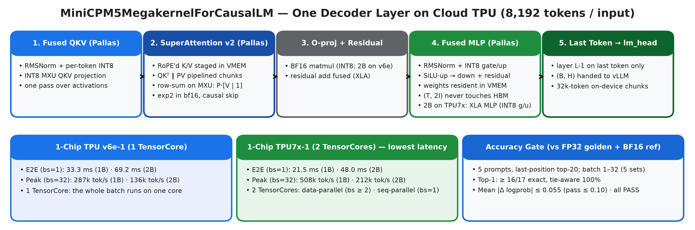
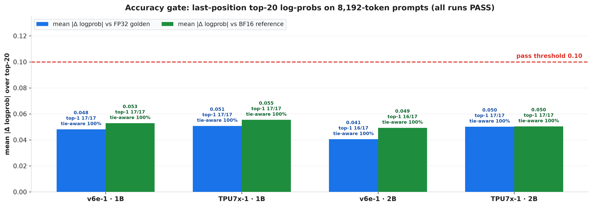

# MiniCPM5 (1B & 2B) on a single Cloud TPU chip with vLLM

A drop-in **vLLM plugin** (`minicpm5_mk`) with custom **JAX / Pallas kernels** that runs
[`openbmb/MiniCPM5-1B`](https://huggingface.co/openbmb/MiniCPM5-1B) and
[`openbmb/MiniCPM5-2B`](https://huggingface.co/openbmb/MiniCPM5-2B) prefill / scoring
(**8,192 tokens per input**, one output token) on **one TPU v6e chip** or **one TPU7x chip** — through the
standard `vllm.LLM` API, on the public [vLLM-TorchTPU](https://github.com/vllm-project/vllm-torchtpu) stack.



| | TPU v6e-1 (1 chip) | TPU7x-1 (1 chip) |
| :--- | ---: | ---: |
| MiniCPM5-1B · 1 × 8,192 tokens, end-to-end | **33.3 ms** | **21.5 ms** |
| MiniCPM5-2B · 1 × 8,192 tokens, end-to-end | **69.2 ms** | **48.0 ms** |
| MiniCPM5-1B · peak throughput | 287k tok/s | 508k tok/s |
| MiniCPM5-2B · peak throughput | 136k tok/s | 212k tok/s |
| Accuracy gate vs FP32 checkpoint | PASS | PASS |

**Contents:** [Results](#results) · [How it works](#how-it-works) · [Accuracy](#accuracy) ·
[Reproduce the results](#reproduce-the-results) · [Use it in your code](#use-it-in-your-code) ·
[Repository layout](#repository-layout) · [FAQ](#faq) · [Technical guide](TECHNICAL_GUIDE.md)

## Results

All numbers are **end-to-end** for 8,192-token inputs: client-side tokenization (the repo's parallel tokenizer,
[`examples/fast_tokenizer.py`](examples/fast_tokenizer.py)) + `llm.generate(...)`, p50 of 50 timed
runs after 5 warm-up runs, one chip, offline and in-process.





**Takeaways**

- **TPU7x-1 is the fastest single chip**: 21.5 ms for one 8,192-token 1B request and
  508k tokens/s peak; 1.55–1.78x (1B) and
  1.44–1.55x (2B) lower latency than TPU v6e-1, using both TensorCores.
- **TPU v6e-1 serves the same workload on one TensorCore**: 33.3 ms (1B) and
  69.2 ms (2B) for one request; up to 287k tokens/s (1B).
- **Throughput is flat from batch 4 to 32** (at most 7% change), so latency grows
  almost linearly with batch size: pick the batch size that fits your latency budget.
- **Accuracy**: all 8 accuracy-gate checks pass
  against a full-FP32 run of the original checkpoint.

<details>
<summary><b>Full tables (click to expand)</b></summary>

**MiniCPM5-1B** (24 layers, H 1,536, 16Q / 2KV heads)

| Shape (batch, tokens) | v6e-1 E2E p50 | v6e-1 E2E p99 | v6e-1 tok/s | TPU7x-1 E2E p50 | TPU7x-1 E2E p99 | TPU7x-1 tok/s | TPU7x-1 vs v6e-1 |
| :--- | ---: | ---: | ---: | ---: | ---: | ---: | ---: |
| `(1, 8192)` | **33.3 ms** | 34.1 ms | 246k | **21.5 ms** | 24.0 ms | 380k | 1.55x faster |
| `(4, 8192)` | **118.8 ms** | 119.8 ms | 276k | **69.1 ms** | 70.6 ms | 474k | 1.72x faster |
| `(8, 8192)` | **233.9 ms** | 235.6 ms | 280k | **133.0 ms** | 134.8 ms | 493k | 1.76x faster |
| `(16, 8192)` | **461.3 ms** | 464.3 ms | 284k | **259.7 ms** | 262.3 ms | 505k | 1.78x faster |
| `(32, 8192)` | **914.9 ms** | 918.3 ms | 287k | **515.5 ms** | 521.4 ms | 508k | 1.77x faster |

**MiniCPM5-2B** (42 layers, H 2,048, 16Q / 2KV heads)

| Shape (batch, tokens) | v6e-1 E2E p50 | v6e-1 E2E p99 | v6e-1 tok/s | TPU7x-1 E2E p50 | TPU7x-1 E2E p99 | TPU7x-1 tok/s | TPU7x-1 vs v6e-1 |
| :--- | ---: | ---: | ---: | ---: | ---: | ---: | ---: |
| `(1, 8192)` | **69.2 ms** | 69.8 ms | 118k | **48.0 ms** | 48.7 ms | 171k | 1.44x faster |
| `(4, 8192)` | **244.9 ms** | 245.6 ms | 134k | **161.3 ms** | 162.9 ms | 203k | 1.52x faster |
| `(8, 8192)` | **486.3 ms** | 488.8 ms | 135k | **313.9 ms** | 316.0 ms | 209k | 1.55x faster |
| `(16, 8192)` | **964.7 ms** | 968.1 ms | 136k | **620.9 ms** | 623.3 ms | 211k | 1.55x faster |
| `(32, 8192)` | **1,922.6 ms** | 1,925.9 ms | 136k | **1,237.2 ms** | 1,243.3 ms | 212k | 1.55x faster |

E2E = end-to-end latency (tokenize + generate); tok/s = tokens ÷ mean E2E latency. A plain `tokenizer(...)`
call instead of the parallel tokenizer would add 13–49 ms
on v6e-1 and 12–33 ms on TPU7x-1 per call (1B runs, same hosts).
</details>

<details>
<summary><b>Run details: hardware, software, method (click to expand)</b></summary>

- **Measured**: 2026-10-29T07:44:50Z – 2026-10-29T07:55:44Z (UTC)
- **Hardware**: TPU v6e-1: one chip, 1 TensorCore, `tensor_parallel_size=1`; TPU7x-1: one chip, 2 TensorCores, `tensor_parallel_size=2` (single-chip GKE TPU nodes)
- **Software**: vLLM 0.32.0 with the TorchTPU backend (vllm-torchtpu; torch 2.13.0, torch_tpu 0.2.0), JAX/jaxlib 0.11.2, libtpu 0.0.50, transformers 5.19.0, tokenizers 0.23.3, Python 3.12.16
- **Library sources**: unmodified; all 7 package roots match `benchmark/pristine_manifest.json` (same sources as the public image `vllm/vllm-torchtpu:nightly-20261027-e91801a-v0.32.0`)
- **Models**: `openbmb/MiniCPM5-1B` @ `87179e5c1f45`, `openbmb/MiniCPM5-2B` @ `f97400052a43` (Hugging Face revisions)
- **Code**: plugin tree sha256 `d9afb05f9f36b7dd`, harness `benchmark/run_benchmark.py` sha256 `1e4693328501da99`
- **Inputs**: fresh random token ids in [1000, 30000) per iteration (seed 1234), decoded to text; re-tokenized to exactly 8,192 tokens inside the timed region
- **Timed region**: offline, in-process: client tokenizer call + blocking `llm.generate(...)`; tokenizer `examples/fast_tokenizer.py` mode `parallel` (ids verified identical to `tokenizer(...)` on 40 calls per run); Python GC frozen after warm-up; `SamplingParams(skip_clone=True)`
- **Iterations**: 5 warm-up + 50 timed per shape; latency = p50 (median, percentiles linearly interpolated); throughput = tokens ÷ mean latency; raw per-iteration samples are in the JSON
- **Sampling**: `SamplingParams(max_tokens=1, min_tokens=1, temperature=0.0, detokenize=False, skip_clone=True)`, prefix caching off
- **Host**: TPU v6e-1: AMD EPYC 9B14, 44 vCPUs, 172.9 GB RAM; TPU7x-1: INTEL(R) XEON(R) PLATINUM 8581C, 56 vCPUs, 235.9 GB RAM

Every number on this page is generated from `results/*.json` by `scripts/generate_docs.py`;
`python3 benchmark/verify_results.py results/*_minicpm5_*.json` re-checks them.
</details>

## How it works



vLLM schedules requests as usual. When a step contains only fresh 8,192-token scoring requests, the plugin runs
the **whole model as one compiled JAX program** (a `jax.lax.scan` over the layers) instead of vLLM's
layer-by-layer path. Each decoder layer is made of:

1. **Fused QKV** (Pallas) — RMSNorm, per-token INT8 quantization and the INT8 QKV matmul in one pass.
2. **SuperAttention v2** (Pallas) — causal GQA flash attention built for the TPU MXU: K/V staged once in VMEM,
   QKᵀ and PV matmuls software-pipelined, softmax row-sum computed by the MXU (`P · [V | 1]`), bf16 `exp2`.
3. **Fused MLP** (Pallas) — RMSNorm, INT8 gate/up, SiLU, down projection and residual add with the weights
   resident in VMEM, so the large intermediate activation never goes to HBM. (TPU7x VMEM cannot hold the 2B MLP
   weights, so 2B on TPU7x-1 runs its MLP as XLA matmuls: INT8 gate/up, BF16 down.)
4. **Last token only** — the last layer computes only the final position and hands it to vLLM's `lm_head` / sampler.
5. **Both TPU7x TensorCores** — even batch sizes are split across the two cores; a single 8,192-token input is
   split by sequence in zig-zag 512-token blocks so both cores get the same causal attention work.

Kernel-level details are in the [technical guide](TECHNICAL_GUIDE.md#3-kernels).

## Accuracy

Every benchmark run first re-scores 5 fixed 8,192-token prompts (the 4-prompt set also inside batches of 8, 16
and 32) and compares the next-token top-20 log-probabilities with a **full-FP32 run of the original Hugging Face
checkpoint** and with **this plugin's BF16 path**. Pass = mean |Δ logprob| ≤ 0.10 nats and tie-aware top-1 ≥ 95%.
All 8 gate checks pass.
This is a numerical-fidelity check on synthetic prompts, not a task-accuracy benchmark; details in the
[technical guide](TECHNICAL_GUIDE.md#4-accuracy-gate).



## Reproduce the results


### Step 1 — Get a single-chip Cloud TPU

The published numbers were measured on **single-chip GKE TPU nodes**: one TPU v6e chip (1 TensorCore) and one
TPU7x chip (2 TensorCores). Any of the following works; replace the `<...>` placeholders with your own values.

**Option A — GKE (how the numbers were measured).** Create (or reuse) a GKE cluster with a single-chip TPU node
pool, then start the ready-made pod from [`deploy/`](deploy):

```bash
# TPU v6e-1 node pool (single-host, 1 chip)
gcloud container node-pools create v6e-1 --cluster=<CLUSTER> --location=<ZONE> \
    --machine-type=ct6e-standard-1t --num-nodes=1

kubectl apply -f deploy/gke-v6e-1.yaml        # or deploy/gke-tpu7x-1.yaml on a 1x1x1 TPU7x node
kubectl exec -it minicpm5-v6e-1 -- bash       # you are now inside the container (Step 3)
```

For TPU7x, use a node pool whose nodes expose a single TPU7x chip (`cloud.google.com/gke-tpu-topology: 1x1x1`);
check what your project and zone offer with `gcloud compute tpus accelerator-types list --zone=<ZONE>`.

**Option B — TPU VM (v6e-1).**

```bash
gcloud compute tpus tpu-vm create minicpm5-v6e-1 --zone=<ZONE> \
    --accelerator-type=v6e-1 --version=v2-alpha-tpuv6e
gcloud compute tpus tpu-vm ssh minicpm5-v6e-1 --zone=<ZONE>
```

### Step 2 — Start the public vLLM-TorchTPU container

Use the public image **`vllm/vllm-torchtpu:nightly-20261027-e91801a-v0.32.0`**. It is built from the same library sources as the measured runs
(vllm-torchtpu commit `e91801a`, vLLM `v0.32.0`, torch_tpu `0.2.0`, JAX `0.11.2`; checked file-by-file against
[`benchmark/pristine_manifest.json`](benchmark/pristine_manifest.json)), and the benchmark re-checks your
container against that manifest on every run.

```bash
# On a TPU VM (GKE pods from deploy/ already run this image)
sudo docker run -it --rm --privileged --net host --shm-size=64G \
    -e HF_HOME=/dev/shm/hf_cache vllm/vllm-torchtpu:nightly-20261027-e91801a-v0.32.0 bash
```

### Step 3 — Install the plugin

```bash
git clone https://github.com/MG-Cafe/minicpm5-vllm-tpu.git
cd minicpm5-vllm-tpu
pip install -e ./plugin --no-build-isolation --no-deps   # registers MiniCPM5MegakernelForCausalLM with vLLM
export PYTHONPATH="$(pwd)/plugin:$(pwd):${PYTHONPATH:-}"
```

The plugin has no extra dependencies; the model weights are downloaded from Hugging Face on first use
(`openbmb/MiniCPM5-1B` / `openbmb/MiniCPM5-2B`, pinned revisions, no token needed).

### Step 4 — Smoke test

```bash
# --tp 1 on TPU v6e-1, --tp 2 on TPU7x-1 (both TensorCores)
python3 examples/minimal_vllm_inference.py --model openbmb/MiniCPM5-1B --tp 1 --batch-size 4 --seq-len 8192
```

The first call per shape compiles the kernels (tens of seconds); the script then prints one timed call, e.g.
`shape=(4, 8192) tp=1 | engine_latency=... ms | throughput=... tok/s`.

### Step 5 — Run the full benchmark

```bash
bash benchmark/run_all_tpu_benchmarks.sh          # both models; MODELS=1b or MODELS=2b for one
```

The script detects the chip (`TPU_ACCELERATOR_TYPE`: `v6e-1` → TP=1, `tpu7x-2` → TP=2; set `ACCEL=v6e` or
`ACCEL=tpu7x` to force it), then for each model: loads the model, runs the accuracy gate against the committed
FP32 and BF16 references, times 5 warm-up + 50 measured iterations for each of the 5 shapes, and writes
`results/<chip>_minicpm5_<model>.json` plus gate dumps in `results/gate/`. It ends by running the verifier.

### Step 6 — Verify and compare

```bash
python3 benchmark/verify_results.py results/*_minicpm5_*.json   # expect: 0 FAIL, 0 WARN
python3 scripts/generate_charts.py && python3 scripts/generate_docs.py   # rebuild charts + docs from your JSONs
```

The verifier re-checks every statistic from the raw per-iteration samples, the accuracy gates, the code hashes,
and that your container's library sources match the reference image (a different image is reported as `WARN`).
Expected p50 end-to-end latency (results from this repo):

| Model | Shape | TPU v6e-1 E2E p50 | TPU7x-1 E2E p50 |
| :--- | :--- | ---: | ---: |
| MiniCPM5-1B | `(1, 8192)` | 33.3 ms | 21.5 ms |
| MiniCPM5-1B | `(4, 8192)` | 118.8 ms | 69.1 ms |
| MiniCPM5-1B | `(8, 8192)` | 233.9 ms | 133.0 ms |
| MiniCPM5-1B | `(16, 8192)` | 461.3 ms | 259.7 ms |
| MiniCPM5-1B | `(32, 8192)` | 914.9 ms | 515.5 ms |
| MiniCPM5-2B | `(1, 8192)` | 69.2 ms | 48.0 ms |
| MiniCPM5-2B | `(4, 8192)` | 244.9 ms | 161.3 ms |
| MiniCPM5-2B | `(8, 8192)` | 486.3 ms | 313.9 ms |
| MiniCPM5-2B | `(16, 8192)` | 964.7 ms | 620.9 ms |
| MiniCPM5-2B | `(32, 8192)` | 1,922.6 ms | 1,237.2 ms |

Run-to-run variation on the same chip is typically within a few percent. The end-to-end time includes
client-side tokenization on the host CPU, so a slower host CPU shows up mostly at small batch sizes.


## Use it in your code

```python
import os
os.environ["VLLM_ENABLE_V1_MULTIPROCESSING"] = "0"
os.environ["TPU_GREEDY_TOP_TOKENS"] = "1"
os.environ["MINICPM5_MK_QUANT"] = "auto"   # picks the best kernels + W8A8 mode per chip
os.environ["MINICPM5_MK_ATTN"] = "auto"    # SuperAttention v2 for 8,192-token inputs
os.environ["MINICPM5_MK_CAL_NSEQ"] = "16"  # SmoothQuant calibration (same as the benchmark)
os.environ["MINICPM5_MK_CAL_SEQ"] = "256"
os.environ["MINICPM5_MK_FREE_STOCK"] = "1" # free the unused stock layer weights (see Supported inputs)

from transformers import AutoTokenizer
from vllm import LLM, SamplingParams
from examples.fast_tokenizer import ClientTokenizer
from examples.minimal_vllm_inference import prepare_local_model_dir

model_dir = prepare_local_model_dir("openbmb/MiniCPM5-1B")
llm = LLM(model=model_dir, tokenizer=model_dir,
          hf_overrides={"architectures": ["MiniCPM5MegakernelForCausalLM"]},
          tensor_parallel_size=1,               # 2 on TPU7x-1 (both TensorCores)
          dtype="bfloat16", enable_prefix_caching=False, max_model_len=8256,
          max_num_batched_tokens=262144, max_num_seqs=32, block_size=256,
          gpu_memory_utilization=0.5,
          compilation_config={"compile_sizes": [8192, 32768, 65536, 131072, 262144]})
sp = SamplingParams(max_tokens=1, min_tokens=1, temperature=0.0, detokenize=False, skip_clone=True)
fast_tok = ClientTokenizer(AutoTokenizer.from_pretrained(model_dir), mode="parallel")

# texts: your batch of input strings. The two timed lines of the benchmark ("end-to-end"):
ids = fast_tok(texts, 8192)  # = tokenizer(texts, padding="max_length", truncation=True, max_length=8192) ids
outputs = llm.generate([{"prompt_token_ids": x} for x in ids], sp)
```

### Supported inputs

The fast path needs every request in a vLLM step to be a fresh `max_tokens=1` prefill with the same prompt
length (a multiple of 1,024 tokens; benchmarked at 8,192) and no prompt logprobs or penalties. With
`MINICPM5_MK_FREE_STOCK=1`, other requests fail with an explicit error; set it to `0` to keep vLLM's stock path
as a fallback. Installing the plugin also adds small host-side patches to vLLM's offline front end;
`MINICPM5_MK_ENABLE=0` disables everything. Details in the
[technical guide](TECHNICAL_GUIDE.md#5-supported-inputs).

## Repository layout

```text
minicpm5-vllm-tpu/
├── plugin/minicpm5_mk/          vLLM plugin: model + Pallas kernels
│   ├── model.py                 MiniCPM5MegakernelForCausalLM (vLLM model class, host fast path)
│   ├── mk_jax.py                whole-model jax.lax.scan, TPU7x dual-core modes
│   ├── mk_attn.py               SuperAttention v2 (causal GQA flash attention) + sequence-parallel variant
│   ├── mk_mlp.py                fused INT8 QKV and fused MLP kernels
│   └── mk_weights.py            weight packing + SmoothQuant W8A8 calibration
├── examples/                    minimal vLLM example + the parallel client tokenizer used in the benchmark
├── benchmark/
│   ├── run_all_tpu_benchmarks.sh  one command: both models, 5 shapes, accuracy gates, verification
│   ├── run_benchmark.py         timing harness (records config, versions, raw samples)
│   ├── verify_results.py        re-checks every published number from the raw samples
│   ├── gate.py, score_gate.py   accuracy gate (top-20 log-prob comparison)
│   ├── f32_golden.py            FP32 Hugging Face reference
│   ├── ref/                     committed FP32 and BF16 reference log-probs
│   └── pristine_manifest.json   library-source hashes of the reference container image
├── results/                     measured JSONs (+ gate dumps) behind every number and chart
├── charts/                      generated charts
├── deploy/                      GKE pod manifests (single-chip TPU v6e and TPU7x)
└── scripts/                     generate_charts.py, generate_docs.py (rebuild charts + docs from results/)
```

## FAQ

- **`TPU_ACCELERATOR_TYPE is unset`** — set `ACCEL=v6e` (TP=1) or `ACCEL=tpu7x` (TP=2) before running the
  benchmark script.
- **`WARN library sources differ from the reference image`** — you are not using `vllm/vllm-torchtpu:nightly-20261027-e91801a-v0.32.0`. The plugin may
  still work, but the published numbers only apply to that image.
- **The first request of every new (batch, length) is slow** — that is the one-time compilation. Set
  `MINICPM5_MK_PRECOMPILE="1x8192,4x8192,8x8192,16x8192,32x8192"` to compile everything at load time.
- **A request fails with an explicit "outside the fast path" error** — see [Supported inputs](#supported-inputs);
  set `MINICPM5_MK_FREE_STOCK=0` to fall back to vLLM's stock path for such requests.
- **Disable the plugin without uninstalling it** — `MINICPM5_MK_ENABLE=0`.
- **Model download is slow / fills the disk** — set `HF_HOME` to a large or RAM-backed directory
  (the scripts default to `/dev/shm/hf_cache`).

## License

Apache 2.0 — see [LICENSE](LICENSE). MiniCPM5 model weights are subject to their own license on Hugging Face.
This is not an officially supported Google product.
