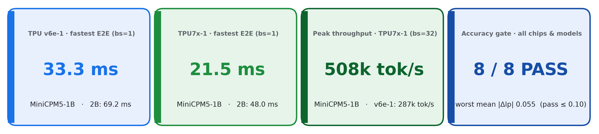
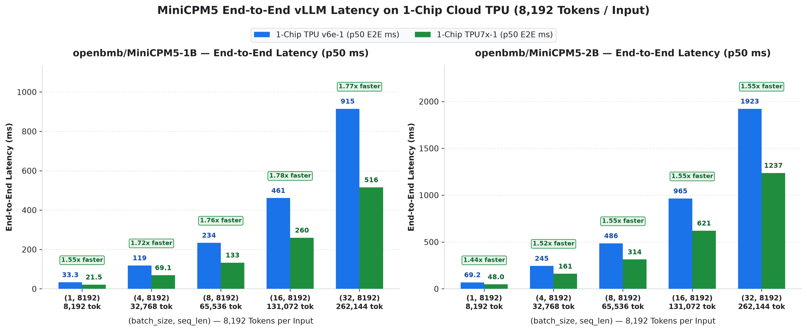
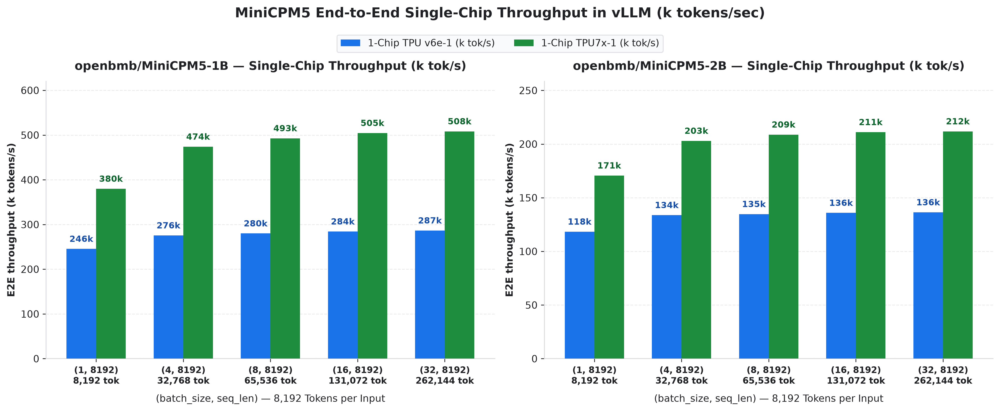
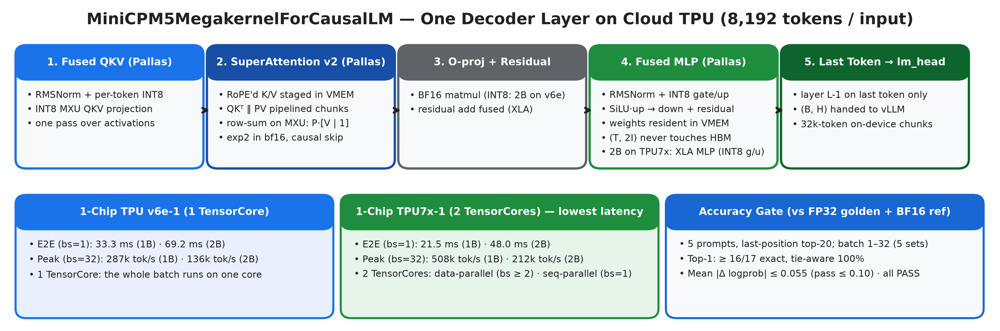
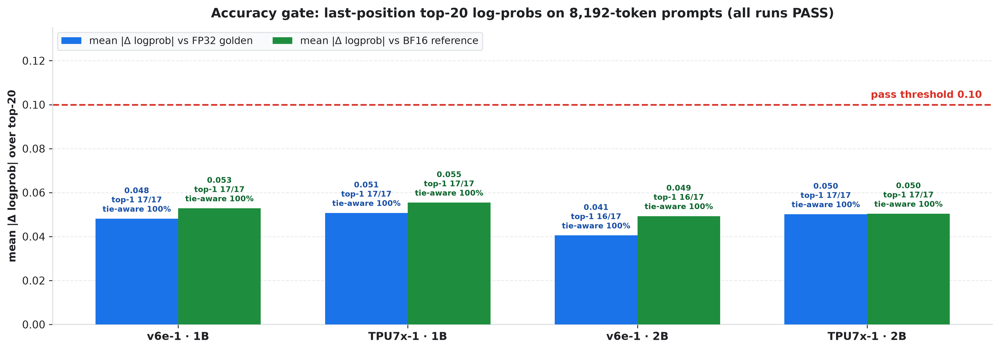

# MiniCPM5 (1B & 2B) on Cloud TPU with vLLM — Technical Guide

**Contents:** [Summary](#summary) · [1. Results](#1-results) · [2. Architecture](#2-architecture) ·
[3. Kernels](#3-kernels) · [4. Accuracy gate](#4-accuracy-gate) · [5. Supported inputs](#5-supported-inputs) ·
[6. Reproduce](#6-reproduce) · [7. Run details](#7-run-details)

## Summary

`minicpm5_mk` is a vLLM-TorchTPU model plugin that serves **MiniCPM5-1B** and **MiniCPM5-2B** prefill /
scoring requests (8,192 tokens per input, `max_tokens=1`) with custom JAX/Pallas kernels, behind the
standard `vllm.LLM` API.



- **TPU7x-1** (one chip, 2 TensorCores): 21.5 ms (1B) and 48.0 ms (2B)
  end-to-end for one 8,192-token request; up to 508k tokens/s (1B).
- **TPU v6e-1** (one chip, 1 TensorCore): 33.3 ms (1B) and 69.2 ms (2B); up to
  287k tokens/s (1B).

## 1. Results

All numbers are end-to-end: client-side tokenization of fresh random 8,192-token prompts plus
`llm.generate(...)`, p50 over 50 timed iterations after 5 warm-up iterations,
`SamplingParams(max_tokens=1, temperature=0)`, prefix caching off. Measured 2026-10-29; full run details
(hardware, software versions, model revisions, code hashes) are in [section 7](#7-run-details).

### End-to-end latency



### Throughput



### Tables

**MiniCPM5-1B** (24 layers, hidden 1,536, intermediate 4,608, 16 query / 2 KV heads, head dim 128)

| Shape (batch, tokens) | v6e-1 E2E p50 | v6e-1 E2E p99 | v6e-1 tok/s | TPU7x-1 E2E p50 | TPU7x-1 E2E p99 | TPU7x-1 tok/s | TPU7x-1 vs v6e-1 |
| :--- | ---: | ---: | ---: | ---: | ---: | ---: | ---: |
| `(1, 8192)` | **33.3 ms** | 34.1 ms | 246k | **21.5 ms** | 24.0 ms | 380k | 1.55x faster |
| `(4, 8192)` | **118.8 ms** | 119.8 ms | 276k | **69.1 ms** | 70.6 ms | 474k | 1.72x faster |
| `(8, 8192)` | **233.9 ms** | 235.6 ms | 280k | **133.0 ms** | 134.8 ms | 493k | 1.76x faster |
| `(16, 8192)` | **461.3 ms** | 464.3 ms | 284k | **259.7 ms** | 262.3 ms | 505k | 1.78x faster |
| `(32, 8192)` | **914.9 ms** | 918.3 ms | 287k | **515.5 ms** | 521.4 ms | 508k | 1.77x faster |

**MiniCPM5-2B** (42 layers, hidden 2,048, intermediate 6,144, 16 query / 2 KV heads, head dim 128)

| Shape (batch, tokens) | v6e-1 E2E p50 | v6e-1 E2E p99 | v6e-1 tok/s | TPU7x-1 E2E p50 | TPU7x-1 E2E p99 | TPU7x-1 tok/s | TPU7x-1 vs v6e-1 |
| :--- | ---: | ---: | ---: | ---: | ---: | ---: | ---: |
| `(1, 8192)` | **69.2 ms** | 69.8 ms | 118k | **48.0 ms** | 48.7 ms | 171k | 1.44x faster |
| `(4, 8192)` | **244.9 ms** | 245.6 ms | 134k | **161.3 ms** | 162.9 ms | 203k | 1.52x faster |
| `(8, 8192)` | **486.3 ms** | 488.8 ms | 135k | **313.9 ms** | 316.0 ms | 209k | 1.55x faster |
| `(16, 8192)` | **964.7 ms** | 968.1 ms | 136k | **620.9 ms** | 623.3 ms | 211k | 1.55x faster |
| `(32, 8192)` | **1,922.6 ms** | 1,925.9 ms | 136k | **1,237.2 ms** | 1,243.3 ms | 212k | 1.55x faster |

E2E = end-to-end latency (tokenize + generate); tok/s = tokens ÷ mean E2E latency.

## 2. Architecture



vLLM schedules the batch as usual. When every request in the step is a fresh 8,192-token prefill with
`max_tokens=1`, the plugin hands the whole batch to one compiled JAX program (via TorchTPU's `jax_op`
bridge) instead of running the stock layer-by-layer path:

- **Whole model in one `jax.lax.scan`** over layers 0 … L-2, with batches above 32,768 tokens processed in
  on-device chunks of 4 × 8,192 tokens (bounded HBM, one dispatch).
- **Last layer on the last token only**: layer L-1 needs keys/values for every position but queries and
  MLP only for the final token, so it returns `(batch, hidden)` straight to vLLM's `lm_head`.
- **Host fast path**: one engine step per batch, token ids staged directly into the input buffer, no KV
  cache blocks allocated for scoring requests.
- **TPU7x-1 uses both TensorCores**: even batch sizes run data-parallel (half the sequences per core);
  batch 1 runs sequence-parallel: each core owns half of the 512-token query blocks (zig-zag order, so
  causal work is balanced), runs the INT8 fused kernels on its tokens and all-gathers K/V once per layer.

## 3. Kernels

### 3.1 SuperAttention v2 (`mk_attn.super_gqa_v2`)

Causal GQA prefill attention for head dim 128 on the 256 × 256 TPU MXU.

- **Grid**: (sequence, 512-token query block). For each KV head the 8 query heads that share it are
  stacked into one `(8 × 512, 128)` matrix, so every K/V tile is read once per KV head.
- **K/V staged once per sequence**: RoPE is applied to K on the MXU and the result kept in VMEM together
  with `V' = [V | 1]`, a copy of V with a ones block appended.
- **MXU row-sum**: `P @ V'` returns both `P·V` and the softmax denominator `Σ P` in one matmul. V only
  fills 128 of the MXU's 256 columns, so the denominator is free and is accumulated in f32 from exactly
  the bf16 `P` used for `P·V`.
- **Pipelined 256-row chunks**: the 4,096 stacked query rows are processed in 256-row chunks; the QKᵀ +
  softmax of chunk *t* overlaps the PV matmul of chunk *t-1*, and the score tile stays in vregs instead
  of round-tripping through VMEM.
- **Cheap softmax**: `log2(e)` is folded into Q, so `P = exp2(S − m)` runs on the bf16 EUP; the running
  max and rescaling stay in f32.
- **Causal work skipping**: blocks above the diagonal are never visited; the first KV block is peeled
  (no zero-init, no rescale), the diagonal block uses a precomputed bias and only the keys each chunk can
  see, interior blocks run two per loop iteration, and the output is normalized straight from vregs.

### 3.2 Fused MLP (`mk_mlp.fused_mlp`)

`x + down(SiLU(gate) · up)` for one layer in a single kernel. Tokens stream through in 512-row tiles
while INT8 `W_gate|up` (interleaved per 1,536-column chunk) and BF16 `W_down` stay resident in VMEM. Each
tile computes RMSNorm statistics, per-token INT8 quantization, the INT8 gate/up matmul, SiLU in f32 and
the down projection chunk by chunk, so the `(tokens × 2·intermediate)` activation never touches HBM.
Weights are read directly from the stacked per-layer tensor via a scalar-prefetched layer index.

### 3.3 Fused QKV (`mk_mlp.fused_qkv`)

RMSNorm + per-token INT8 quantization + INT8 QKV matmul + dequantization in one pass over the
activations (the norm scale is folded into the dequantization factor).

### 3.4 Batch 1 on both TPU7x TensorCores (`mk_attn.super_gqa_v2_sp`)

One 8,192-token request is split across the two TensorCores by 512-token query blocks in zig-zag order
(core 0: blocks 0, 3, 4, 7, …; core 1: blocks 1, 2, 5, 6, …), which gives both cores the same causal
attention work. Each core runs the fused QKV / MLP kernels on its 4,096 tokens, all-gathers the K/V of
each layer (8 MB), and runs the attention kernel on its own query blocks with global positions for RoPE
and the causal mask. The core index is passed in as a sharded operand.

### 3.5 Quantization

SmoothQuant-style W8A8 (α = 0.5) with per-output-channel INT8 weights and per-token dynamic INT8
activations; SmoothQuant scales are calibrated at load time on 16 × 256 random-token sequences (seed 42) whose
first token is id 1 (`</s>`). Calibrating with BOS (id 0) first instead measured slightly worse on the accuracy
gate (2B on v6e-1: mean |Δ logprob| 0.062 vs 0.040), so id 1 is the default (`MINICPM5_MK_CAL_FIRST_ID`).
`MINICPM5_MK_QUANT=auto` resolved to the following in the measured runs (read from each run's recorded plugin
status, `results/*.json` → `config.plugin_status`):

| Chip / model | Linear layers in INT8 (W8A8) | Fused Pallas kernels | Core split (TPU7x) | Resolved `quant` string |
| :--- | :--- | :--- | :--- | :--- |
| TPU v6e-1 · 1B | QKV, gate/up | fused QKV + fused MLP | — | `int8d:qkv+gu|sq|lastbf16|fqkv|fmlp` |
| TPU v6e-1 · 2B | QKV, gate/up, O | fused QKV + fused MLP | — | `int8d:qkv+gu+o|sq|lastbf16|fqkv|fmlp` |
| TPU7x-1 · 1B | QKV, gate/up | fused QKV + fused MLP | dp, sp | `int8d:qkv+gu|sq|lastbf16|fqkv|fmlp` |
| TPU7x-1 · 2B | QKV, gate/up | fused QKV | dp, sp | `int8d:qkv+gu|sq|lastbf16|fqkv` |

The last layer always runs in BF16.

## 4. Accuracy gate

Before timing, each run re-scores **5 fixed 8,192-token prompts** (random-token text, seed 20261027: one batch of
1 and one of 4) and compares the **last-position top-20 next-token log-probabilities** with two references:

- **FP32 golden**: the HF checkpoint run in full FP32 (`benchmark/f32_golden.py`).
- **Plugin BF16 path**: this plugin with `MINICPM5_MK_QUANT=bf16` (committed reference).

The 4-prompt set is also run inside batches of 8, 16 and 32 (seeded filler prompts after it), so every published
batch size is scored, and those outputs are compared with the batch-4 outputs of the same run (batch invariance).
A run passes if mean |Δ logprob| over the reference top-20 ≤ 0.10 nats and tie-aware top-1 ≥ 95%.
"Tie-aware" forgives a top-1 change only when the two tokens are within 0.1 nats in the reference or exactly
tied in the candidate. Exact top-1 is reported next to it. (A logprob cosine ≥ 0.99 is also recorded, but it is
not discriminative and is not used as evidence here.)

Limits: these prompts are random-token text with flat next-token distributions and only the last position is
scored, so this is a numerical-fidelity check of the kernels, not a task-accuracy evaluation.



| Run | vs FP32 golden: top-1 exact / tie-aware · mean \|Δlp\| · cos | vs BF16 reference: top-1 exact / tie-aware · mean \|Δlp\| · cos | Gate |
| :--- | :---: | :---: | :---: |
| TPU v6e-1 · 1B | 17/17 / 100% · 0.048 · 0.99997 | 17/17 / 100% · 0.053 · 0.99996 | **PASS** |
| TPU7x-1 · 1B | 17/17 / 100% · 0.051 · 0.99997 | 17/17 / 100% · 0.055 · 0.99996 | **PASS** |
| TPU v6e-1 · 2B | 16/17 / 100% · 0.041 · 0.99997 | 16/17 / 100% · 0.049 · 0.99995 | **PASS** |
| TPU7x-1 · 2B | 17/17 / 100% · 0.050 · 0.99995 | 17/17 / 100% · 0.050 · 0.99995 | **PASS** |

## 5. Supported inputs

The fast path runs when **every request in a vLLM step** is a fresh prefill with `max_tokens=1` and all
prompts in the step have the **same length**: a multiple of 1,024 tokens, or of 128 tokens up to 1,024
(at most `max_model_len`). LoRA, speculative decoding, prompt embeddings and multimodal inputs are not
supported on the fast path. Everything was benchmarked at 8,192 tokens per input with batch 1, 4, 8, 16 and 32.

- **First use of a shape compiles** the program for that (batch, length) once; set
  `MINICPM5_MK_PRECOMPILE="1x8192,4x8192,8x8192,16x8192,32x8192"` to compile at load time instead.
- **`MINICPM5_MK_FREE_STOCK=1`** (used in the benchmark) frees vLLM's stock layer weights to save memory, so a
  request outside the envelope above fails with an explicit error. Use `MINICPM5_MK_FREE_STOCK=0` to keep the
  stock vLLM path as a (slower) fallback for other request shapes.
- **TPU7x-1** splits work across its two TensorCores: even batch sizes run data-parallel, batch 1 runs
  sequence-parallel (lengths that are multiples of 2,048). Other odd batch sizes run a BF16 head-sharded
  tensor-parallel mode with different numerics; it is not covered by the published numbers.
- **Sampling features** outside the fast path (prompt logprobs, repetition / presence / frequency penalties,
  `min_p`, logit bias, allowed or bad words, structured output) route the request to the stock path (or raise with
  `MINICPM5_MK_FREE_STOCK=1`); temperature, top-p, top-k, seed, `logprobs` and `min_tokens` are supported.
- **Host-side patches**: installing the plugin also patches vLLM's offline front end in every process (one
  `SamplingParams` copy per `generate()` call, cached EOS id, no re-processing of token-id prompts, single-step
  scheduling of `max_tokens=1` batches) and, only for engines serving this model with
  `MINICPM5_MK_FREE_STOCK=1`, skips KV-cache allocation for fast-path requests. `MINICPM5_MK_ENABLE=0` turns
  all of it off.

## 6. Reproduce

The full step-by-step guide (TPU provisioning, container, install, smoke test, benchmark, verification and the
expected numbers) is in the [README](README.md#reproduce-the-results). In short:

```bash
# Inside the vllm/vllm-torchtpu:nightly-20261027-e91801a-v0.32.0 container on a 1-chip TPU (see "Reproduce the results")
git clone https://github.com/MG-Cafe/minicpm5-vllm-tpu.git
cd minicpm5-vllm-tpu
pip install -e ./plugin --no-build-isolation --no-deps
export PYTHONPATH="$(pwd)/plugin:$(pwd):${PYTHONPATH:-}"

# Smoke test (~2-3 min incl. download + compile). --tp 1 on TPU v6e-1, --tp 2 on TPU7x-1
python3 examples/minimal_vllm_inference.py --model openbmb/MiniCPM5-1B --tp 1 --batch-size 4 --seq-len 8192

# Every number in this repo: 2 models x 5 shapes + accuracy gates + verification (~10 min per chip)
bash benchmark/run_all_tpu_benchmarks.sh
```

`run_all_tpu_benchmarks.sh` detects the chip (v6e-1 → TP=1, TPU7x-1 → TP=2), runs both models over all five
shapes, checks accuracy against both references, writes `results/*.json` and verifies them with
`benchmark/verify_results.py`. `scripts/generate_charts.py` and `scripts/generate_docs.py` rebuild every
chart and this guide from those JSON files.

### Use from your own vLLM code

```python
import os
os.environ["VLLM_ENABLE_V1_MULTIPROCESSING"] = "0"
os.environ["TPU_GREEDY_TOP_TOKENS"] = "1"
os.environ["MINICPM5_MK_QUANT"] = "auto"   # picks the best kernels + W8A8 mode per chip
os.environ["MINICPM5_MK_ATTN"] = "auto"    # SuperAttention v2 for 8,192-token inputs
os.environ["MINICPM5_MK_CAL_NSEQ"] = "16"  # SmoothQuant calibration (same as the benchmark)
os.environ["MINICPM5_MK_CAL_SEQ"] = "256"
os.environ["MINICPM5_MK_FREE_STOCK"] = "1" # free the unused stock layer weights (see Supported inputs)

from transformers import AutoTokenizer
from vllm import LLM, SamplingParams
from examples.fast_tokenizer import ClientTokenizer
from examples.minimal_vllm_inference import prepare_local_model_dir

model_dir = prepare_local_model_dir("openbmb/MiniCPM5-1B")
llm = LLM(model=model_dir, tokenizer=model_dir,
          hf_overrides={"architectures": ["MiniCPM5MegakernelForCausalLM"]},
          tensor_parallel_size=1,               # 2 on TPU7x-1 (both TensorCores)
          dtype="bfloat16", enable_prefix_caching=False, max_model_len=8256,
          max_num_batched_tokens=262144, max_num_seqs=32, block_size=256,
          gpu_memory_utilization=0.5,
          compilation_config={"compile_sizes": [8192, 32768, 65536, 131072, 262144]})
sp = SamplingParams(max_tokens=1, min_tokens=1, temperature=0.0, detokenize=False, skip_clone=True)
fast_tok = ClientTokenizer(AutoTokenizer.from_pretrained(model_dir), mode="parallel")

# texts: your batch of input strings. The two timed lines of the benchmark ("end-to-end"):
ids = fast_tok(texts, 8192)  # = tokenizer(texts, padding="max_length", truncation=True, max_length=8192) ids
outputs = llm.generate([{"prompt_token_ids": x} for x in ids], sp)
```

## 7. Run details

| Item | Value |
| :--- | :--- |
| Measured | 2026-10-29T07:44:50Z – 2026-10-29T07:55:44Z (UTC) |
| Hardware | TPU v6e-1: one chip, 1 TensorCore, `tensor_parallel_size=1`; TPU7x-1: one chip, 2 TensorCores, `tensor_parallel_size=2` (single-chip GKE TPU nodes) |
| Software | vLLM 0.32.0 with the TorchTPU backend (vllm-torchtpu; torch 2.13.0, torch_tpu 0.2.0), JAX/jaxlib 0.11.2, libtpu 0.0.50, transformers 5.19.0, tokenizers 0.23.3, Python 3.12.16 |
| Library sources | unmodified; all 7 package roots match `benchmark/pristine_manifest.json` (same sources as the public image `vllm/vllm-torchtpu:nightly-20261027-e91801a-v0.32.0`) |
| Models | `openbmb/MiniCPM5-1B` @ `87179e5c1f45`, `openbmb/MiniCPM5-2B` @ `f97400052a43` (Hugging Face revisions) |
| Code | plugin tree sha256 `d9afb05f9f36b7dd`, harness `benchmark/run_benchmark.py` sha256 `1e4693328501da99` |
| Inputs | fresh random token ids in [1000, 30000) per iteration (seed 1234), decoded to text; re-tokenized to exactly 8,192 tokens inside the timed region |
| Timed region | offline, in-process: client tokenizer call + blocking `llm.generate(...)`; tokenizer `examples/fast_tokenizer.py` mode `parallel` (ids verified identical to `tokenizer(...)` on 40 calls per run); Python GC frozen after warm-up; `SamplingParams(skip_clone=True)` |
| Iterations | 5 warm-up + 50 timed per shape; latency = p50 (median, percentiles linearly interpolated); throughput = tokens ÷ mean latency; raw per-iteration samples are in the JSON |
| Sampling | `SamplingParams(max_tokens=1, min_tokens=1, temperature=0.0, detokenize=False, skip_clone=True)`, prefix caching off |
| Host | TPU v6e-1: AMD EPYC 9B14, 44 vCPUs, 172.9 GB RAM; TPU7x-1: INTEL(R) XEON(R) PLATINUM 8581C, 56 vCPUs, 235.9 GB RAM |
| Engine kwargs (TPU v6e-1) | `{"enable_prefix_caching":false,"max_model_len":8256,"max_num_batched_tokens":262144,"max_num_seqs":32,"dtype":"bfloat16","seed":0,"hf_overrides":{"architectures":["MiniCPM5MegakernelForCausalLM"]},"tensor_parallel_size":1,"block_size":256,"compilation_config":{"compile_sizes":[8192,32768,65536,131072,262144]},"gpu_memory_utilization":0.5}` |
| Engine kwargs (TPU7x-1) | `{"enable_prefix_caching":false,"max_model_len":8256,"max_num_batched_tokens":262144,"max_num_seqs":32,"dtype":"bfloat16","seed":0,"hf_overrides":{"architectures":["MiniCPM5MegakernelForCausalLM"]},"tensor_parallel_size":2,"block_size":256,"compilation_config":{"compile_sizes":[8192,32768,65536,131072,262144]},"gpu_memory_utilization":0.5}` |
| Environment | `MINICPM5_MK_QUANT=auto MINICPM5_MK_ATTN=auto MINICPM5_MK_FREE_STOCK=1 MINICPM5_MK_LOG_EVERY=0 VLLM_ENABLE_V1_MULTIPROCESSING=0 TPU_GREEDY_TOP_TOKENS=1 MINICPM5_MK_CAL_NSEQ=16 MINICPM5_MK_CAL_SEQ=256` |

Gate dumps of every run (`results/gate/*.json.gz`) can be re-scored with `python3 benchmark/score_gate.py REF CAND`.
Every number in this guide is generated from `results/*.json` by `scripts/generate_docs.py`;
`python3 benchmark/verify_results.py results/*_minicpm5_*.json` re-checks the files: methodology, accuracy gates,
raw per-iteration samples against every statistic, that the recorded plugin and harness hashes match this
repository, and that the library sources match the reference container image. Host names and cluster metadata in
the published JSON files are redacted; the measurements are unchanged.
